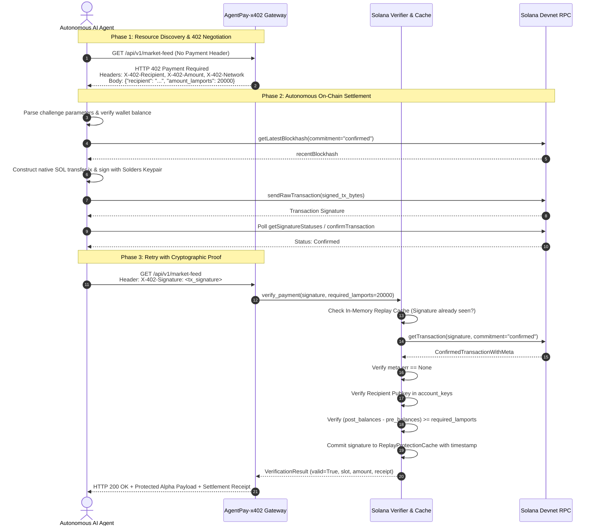

# AgentPay-x402: Autonomous HTTP 402 Payment Gateway on Solana Devnet

[](https://fastapi.tiangolo.com)
[](https://solana.com)
[](https://python.org)
[](#)

**AgentPay-x402** is a high-throughput, autonomous HTTP 402 Payment Gateway built for machine-to-machine (M2M) micropayments and AI agent compute economies on Solana Devnet.

It standardizes the **RFC/x402 protocol** for autonomous agents: APIs challenge incoming requests with standard HTTP 402 headers and parameters, autonomous agents intercept the challenge, construct and sign native SOL transfers on Solana Devnet, await on-chain settlement, and retry with cryptographic settlement proofs.

---

## 1. High-Level Architecture

### Autonomous Settlement Sequence Flow



### System Component Architecture

```
┌────────────────────────────────────────────────────────────────────────┐
│                        Autonomous AI Agent                             │
│  - client/wallet_manager.py : Solana Keypair & Devnet Faucet Manager   │
│  - client/agent.py          : 402 Interceptor, Tx Builder, Retry Loop  │
└───────────────────────────────────┬────────────────────────────────────┘
                                    │ HTTP Requests / X-402 Proofs
                                    ▼
┌────────────────────────────────────────────────────────────────────────┐
│                      AgentPay-x402 Server Gateway                      │
│  ┌──────────────────────────────────────────────────────────────────┐  │
│  │ server/main.py: FastAPI Endpoints & RequireX402Payment Middleware │  │
│  │  - GET  /health              (Public health & price discovery)   │  │
│  │  - GET  /api/v1/market-feed  (Protected: 20,000 lamports)        │  │
│  │  - POST /api/v1/agent-infer  (Protected: 5,000 lamports)         │  │
│  └──────────────────────────────────┬───────────────────────────────┘  │
│                                     │ Calls                            │
│  ┌──────────────────────────────────▼───────────────────────────────┐  │
│  │ server/verifier.py: SolanaTransactionVerifier                    │  │
│  │  - In-Memory ReplayProtectionCache (Timestamped, TTL eviction)   │  │
│  │  - Balance Differential Validation (Pre/Post balance math)       │  │
│  │  - On-Chain Status & Commitment Check (Confirmed / Finalized)    │  │
│  └──────────────────────────────────┬───────────────────────────────┘  │
│                                     │ Ingests settings                 │
│  ┌──────────────────────────────────▼───────────────────────────────┐  │
│  │ server/config.py: Pydantic Settings & Dynamic Price Registry     │  │
│  └──────────────────────────────────────────────────────────────────┘  │
└───────────────────────────────────┬────────────────────────────────────┘
                                    │ JSON-RPC (AsyncClient)
                                    ▼
┌────────────────────────────────────────────────────────────────────────┐
│                 Solana Devnet Cluster (Validators / RPC)               │
│  - Native SOL transfers via System Program (11111111111111111111...)   │
└────────────────────────────────────────────────────────────────────────┘
```

---

## 2. Directory Structure

```
AgentPay-x402/
├── .env.example              # Environment variables template
├── requirements.txt          # Production pinned dependencies
├── README.md                 # Complete system documentation
├── server/
│   ├── __init__.py           # Server package marker
│   ├── config.py             # Pydantic Settings & dynamic price registry
│   ├── verifier.py           # On-chain settlement verifier & replay protection
│   └── main.py               # FastAPI application & x402 middleware gate
├── client/
│   ├── __init__.py           # Client package marker
│   ├── wallet_manager.py     # Solana keypair manager & Devnet airdrop assistant
│   └── agent.py              # Autonomous 402 negotiation agent & CLI runner
└── tests/
    ├── __init__.py           # Test package marker
    └── test_gateway.py       # Unit and integration test suite
```

---

## 3. Installation & Setup

### Prerequisites
- Python 3.10+ (tested on Python 3.10, 3.11, 3.12, 3.14)
- (Optional) Solana CLI tools (`solana-keygen`, `solana airdrop`)

### 1. Install Dependencies
```bash
pip install -r requirements.txt
```

### 2. Configure Environment
Copy `.env.example` to `.env`:
```bash
cp .env.example .env
```

Configuration variables:
| Variable | Default | Description |
|---|---|---|
| `SOLANA_RPC_URL` | `https://api.devnet.solana.com` | Solana Devnet JSON-RPC endpoint |
| `MERCHANT_PUBLIC_KEY` | *(Auto-generated)* | Base58 public key of merchant receiving SOL |
| `MERCHANT_KEYPAIR_PATH` | `merchant_keypair.json` | Path to save/load merchant keypair |
| `SOLANA_NETWORK` | `solana-devnet` | Network identifier string |
| `SOLANA_COMMITMENT` | `confirmed` | RPC confirmation level (`confirmed` or `finalized`) |
| `REPLAY_CACHE_TTL_SECONDS` | `86400` | Replay protection signature cache TTL in seconds |
| `HOST` | `0.0.0.0` | Gateway host bind address |
| `PORT` | `8000` | Gateway port bind |

*Note: If `MERCHANT_PUBLIC_KEY` is left blank, the server will automatically create and persist a dedicated merchant keypair to `merchant_keypair.json` on first run.*

---

## 4. Running the Gateway Server

Start the FastAPI gateway with Uvicorn:

```bash
uvicorn server.main:app --host 0.0.0.0 --port 8000 --reload
```

Output:
```
==================================================
       AgentPay-x402 Gateway Initialized         
 Network:           solana-devnet
 RPC Endpoint:      https://api.devnet.solana.com
 Merchant Pubkey:   DFKexhpaeRnbrfX1DtAmpz9fcFMEsbtcFQBtWFwZhtdY
 Commitment:        confirmed
 Price Registry:
   /api/v1/market-feed       -> 20,000 lamports (0.000020 SOL)
   /api/v1/agent-inference   -> 5,000 lamports (0.000005 SOL)
==================================================
INFO:     Uvicorn running on http://0.0.0.0:8000
```

Verify gateway health:
```bash
curl -s http://127.0.0.1:8000/health
```

### Access Interactive Web UI Dashboard
Open your browser to:
```
http://127.0.0.1:8000/
```
Features available on the web dashboard:
- **Live Wallets & Balances**: Real-time display of Merchant Recipient and Autonomous Agent balances on Solana Devnet.
- **Simulate AI Agent Run**: 1-click trigger of autonomous M2M loop with live Server-Sent Events (SSE) terminal streaming.
- **Unauthenticated Browser Test**: Real-time inspection of raw `HTTP 402 Payment Required` headers and challenge parameters.
- **Live Activity Feed**: Real-time cards showing requests, status codes, lamports settled, and clickable Solana Explorer Devnet links.


---

## 5. Funding the Agent Keypair on Devnet

The autonomous client (`client/agent.py`) uses `client/wallet_manager.py` to manage `agent_keypair.json`.

On initialization, the agent checks its balance. If below 0.05 SOL, it automatically requests an airdrop on Solana Devnet.

### Manual Funding (If Public Faucet is Rate-Limited)
Public Devnet faucets (`api.devnet.solana.com`) frequently throttle automated requests. To fund your agent keypair manually:

1. Retrieve the agent's public key:
   ```bash
   python -c "from client.wallet_manager import SolanaWalletManager; print(SolanaWalletManager().pubkey_str)"
   ```
2. Airdrop Devnet SOL via Solana CLI:
   ```bash
   solana airdrop 1 <AGENT_PUBLIC_KEY> --url devnet
   ```
   Or visit the web faucet at **[faucet.solana.com](https://faucet.solana.com)** or **[faucet.quicknode.com/solana/devnet](https://faucet.quicknode.com/solana/devnet)** and paste your key.

---

## 6. Executing the Autonomous Settlement Loop

Run the end-to-end autonomous agent workflow:

```bash
python client/agent.py --mode demo
```

### What Happens in the Demo:
1. **Health Discovery**: Queries `/health` to discover merchant public key, network, and price registry.
2. **Task 1: Market Feed**:
   - Sends `GET /api/v1/market-feed` without payment header.
   - Intercepts `HTTP 402 Payment Required`.
   - Extracts recipient and `20,000 lamports` price.
   - Constructs and signs native SOL transfer using Solders.
   - Broadcasts to Solana Devnet and awaits confirmation.
   - Retries with `X-402-Signature: <signature>`.
   - Logs latencies, signature, and DeFi alpha payload.
3. **Task 2: Agent Compute Inference**:
   - Sends `POST /api/v1/agent-inference` with JSON prompt.
   - Intercepts `HTTP 402` (price: `5,000 lamports`).
   - Settles payment on Devnet.
   - Retries with settlement signature and receives executable action plan.
4. **Task 3: Replay Attack Defense Verification**:
   - Re-submits the previous signature to `/api/v1/market-feed`.
   - Verifies the gateway blocks the request with `HTTP 402 (Replay detected)`.

### Command Line Options
```bash
# Run specific endpoint
python client/agent.py --mode market-feed
python client/agent.py --mode inference --prompt "Find cross-DEX arbitrage between Orca and Raydium"

# Target custom gateway or RPC
python client/agent.py --gateway-url http://127.0.0.1:8000 --rpc-url https://api.devnet.solana.com
```

---

## 7. Protocol Specification & Responses

### 1. HTTP 402 Challenge (Unpaid Request)
**Headers:**
```http
HTTP/1.1 402 Payment Required
X-402-Recipient: DFKexhpaeRnbrfX1DtAmpz9fcFMEsbtcFQBtWFwZhtdY
X-402-Amount: 20000
X-402-Network: solana-devnet
X-402-Token: SOL
Content-Type: application/json
```
**Body:**
```json
{
  "error": "Payment Required",
  "recipient": "DFKexhpaeRnbrfX1DtAmpz9fcFMEsbtcFQBtWFwZhtdY",
  "amount_lamports": 20000,
  "token": "SOL",
  "network": "solana-devnet"
}
```

### 2. HTTP 200 OK (Settled Request)
**Headers:**
```http
X-402-Signature: 5hT7X...
```
**Body (Example: `/api/v1/market-feed`):**
```json
{
  "status": "success",
  "feed": "solana_defi_deep_alpha",
  "timestamp": "2026-10-12T14:07:56.799555+00:00",
  "market_snapshot": {
    "sol_usd_index": 156.45,
    "aggregate_dex_volume_24h": "$1,482,900,000",
    "jupiter_routed_tps": 512,
    "solana_tps_active": 2980,
    "gas_base_fee_micro_lamports": 1200
  },
  "alpha_signals": [
    {
      "symbol": "SOL",
      "bias": "ACCUMULATION",
      "confidence_score": 0.942,
      "recommended_agent_action": "REBALANCE_LONG_LP"
    }
  ],
  "settlement_receipt": {
    "valid": true,
    "signature": "5hT7X9...",
    "slot": 12345678,
    "amount_lamports": 20000,
    "sender": "8ikVQ5...",
    "recipient": "DFKexh...",
    "confirmation_status": "confirmed",
    "settled_at": "2026-10-12T14:08:02.123456+00:00"
  }
}
```

---

## 8. Security Guarantees

1. **Cryptographic Replay Attack Immunity**:
   Every signature processed by `verifier.py` is committed to `ReplayProtectionCache`. If an agent or attacker re-submits a previously confirmed signature, the request is immediately rejected.
2. **Balance Differential Settlement**:
   Verification computes `post_balances[merchant_idx] - pre_balances[merchant_idx]`. This ensures the merchant **actually received** net lamports $\ge \text{required\_lamports}$, regardless of complex instruction wrapping or intermediate routing.
3. **Commitment Enforcement**:
   Transactions must be confirmed at `Confirmed` or `Finalized` commitment level. Unconfirmed or pending transactions are rejected.
4. **On-Chain Failure Rejection**:
   If a transaction was broadcast but failed due to custom program errors (`meta.err != None`), settlement verification fails.

---

## 9. Running the Test Suite

Run the full pytest suite:

```bash
pytest -v
```

Expected output:
```
tests/test_gateway.py::test_server_config_defaults PASSED                [  7%]
tests/test_gateway.py::test_replay_protection_cache PASSED               [ 15%]
tests/test_gateway.py::test_verifier_malformed_signature PASSED          [ 23%]
tests/test_gateway.py::test_verifier_replay_detection PASSED             [ 30%]
tests/test_gateway.py::test_verifier_mocked_settlement_success PASSED    [ 38%]
tests/test_gateway.py::test_verifier_mocked_insufficient_payment PASSED  [ 46%]
tests/test_gateway.py::test_verifier_mocked_wrong_recipient PASSED       [ 53%]
tests/test_gateway.py::test_wallet_manager_create_and_reload PASSED      [ 61%]
tests/test_gateway.py::test_gateway_health_endpoint PASSED               [ 69%]
tests/test_gateway.py::test_gateway_402_challenge_market_feed PASSED     [ 76%]
tests/test_gateway.py::test_gateway_402_challenge_agent_inference PASSED [ 84%]
tests/test_gateway.py::test_gateway_settled_payment_market_feed PASSED   [ 92%]
tests/test_gateway.py::test_gateway_settled_payment_agent_inference PASSED [100%]

============================= 13 passed in 1.57s ==============================
```

---

## 10. License
MIT License. Built for autonomous AI agents and open Web3 machine compute economies.
