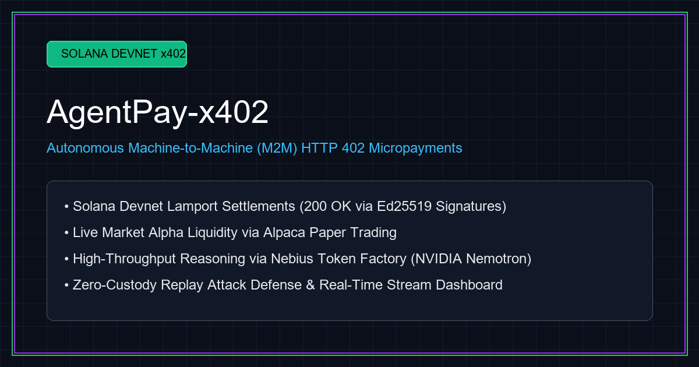
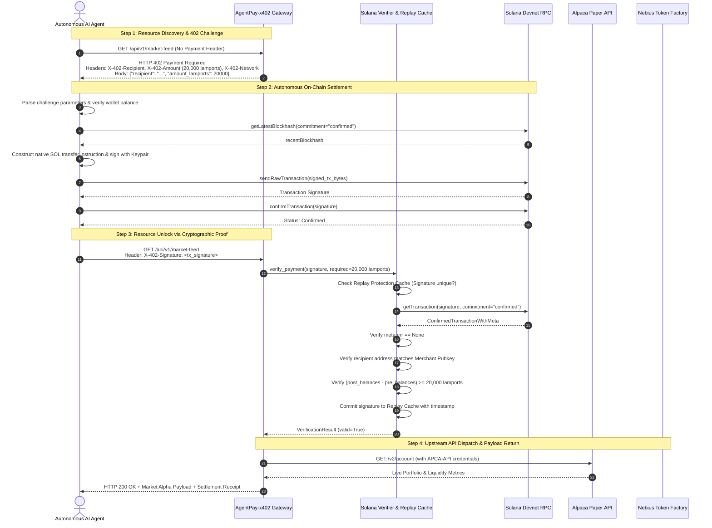

# AgentPay-x402: Autonomous Machine-to-Machine (M2M) HTTP 402 Gateway on Solana

[](https://solana.com)
[](https://python.org)
[](https://fastapi.tiangolo.com)
[](https://tokenfactory.nebius.com)
[](https://alpaca.markets)
[](https://opensource.org/licenses/MIT)

<p align="center">
  
</p>

> **Autonomous HTTP 402 Micropayment Gateway on Solana Devnet tailored for autonomous AI agents, machine-to-machine (M2M) micro-commerce, real-time quantitative alpha streams, and high-performance LLM compute settlements.**

---

## 1. Executive Overview

### The Problem: AI Agents Lack Native Value Channels
Modern autonomous AI agents routinely generate decisions, trade assets, aggregate market feeds, and call specialized inference models. However, standard web architectures rely on human-centric payment gateways (Stripe, monthly credit card subscriptions, API keys requiring KYC and manual onboarding). This friction breaks the autonomous loop:
- Agents cannot autonomously spin up credit card subscriptions.
- Pre-funded API keys suffer from credit leakage, custody risks, and vendor lock-in.
- Traditional payment rails (ACH, Visa) cannot clear atomic sub-cent micropayments ($0.0001 per token/request) without prohibitive processing fees.

### The Solution: Solana Lamport Settlement + RFC/x402 Protocol
**AgentPay-x402** revitalizes the original Web standard—**HTTP 402 Payment Required**—powered by the Solana blockchain.
1. **Zero-Custody Micro-Settlement**: Protected endpoints challenge incoming requests without authorization by returning an `HTTP 402 Payment Required` response containing the merchant receiving address, dynamic lamport pricing, and network parameters.
2. **Autonomous Negotiation**: The client AI agent intercepts the 402 challenge, programmatically builds and signs an on-chain Ed25519 native SOL transfer transaction, broadcasts it to Solana Devnet, and awaits commitment.
3. **Cryptographic Proof Unlocking**: The agent retries the resource request presenting the transaction hash via the `X-402-Signature` header.
4. **On-Chain Settlement Verification**: The gateway independently queries Solana Devnet RPC, mathematically verifies the balance differential and merchant recipient, registers the signature in a replay-protection shield, and instantly unlocks protected financial feeds and high-throughput LLM compute.

---

## 2. Core Architecture & Protocol Sequence

### System Topology Diagram

```
                                 ┌─────────────────────────────────────────┐
                                 │       Autonomous Client AI Agent        │
                                 │  - Ed25519 Keypair / Wallet Manager     │
                                 │  - Autonomous 402 Challenge Interceptor │
                                 └────────────────────┬────────────────────┘
                                                      │
                            1. HTTP Probe (No Header) │ 3. Retry + X-402-Signature
                            2. HTTP 402 Challenge     │ 4. HTTP 200 OK Payload
                                                      ▼
                                 ┌─────────────────────────────────────────┐
                                 │        AgentPay-x402 HTTP Gateway       │
                                 │  - FastAPI Protected Endpoints          │
                                 │  - Dynamic Lamport Price Registry       │
                                 │  - In-Memory Signature Replay Shield    │
                                 └───────┬────────────┬────────────┬───────┘
                                         │            │            │
             ┌───────────────────────────┘            │            └──────────────────────────┐
             ▼                                        ▼                                       ▼
┌─────────────────────────┐      ┌─────────────────────────┐      ┌──────────────────────────┐
│   Solana Devnet RPC     │      │   Alpaca Paper Trading  │      │  Nebius Token Factory    │
│ - On-chain Verifier     │      │ - Live Portfolio Values │      │ - NVIDIA Nemotron LLM    │
│ - Balance Differential  │      │ - Buying Power / Cash   │      │ - Deep Quantitative     │
│ - Lamport Settlement    │      │ - Market Liquidity      │      │   Reasoning Traces       │
└─────────────────────────┘      └─────────────────────────┘      └──────────────────────────┘
```

### Protocol Sequence Flow



---

## 3. Key Features

- **Standardized RFC/x402 Implementation**: Seamlessly serves HTTP 402 status codes with compliant `X-402-Recipient`, `X-402-Amount`, `X-402-Network`, and `X-402-Token` response headers.
- **On-Chain Settlement Verification**: Built with `solders` and `solana-py`. Inspects `ConfirmedTransactionWithMeta`, evaluates pre/post lamport balance differentials, confirms block inclusion status, and verifies recipient public key matching.
- **Replay Attack Shield**: In-memory, thread-safe replay cache with configurable TTL (default 24h) and periodic background garbage collection prevents double-spending the same transaction signature.
- **Sub-Second Settlement Latency**: Micro-transfers settle in ~250ms on Solana Devnet with transaction fees under $0.00001.
- **Live Upstream Integrations**:
  - **Alpaca Paper Markets**: Delivers genuine portfolio value, buying power, cash balances, and status metrics.
  - **Nebius Token Factory**: Queries state-of-the-art NVIDIA Nemotron models (`nvidia/Nemotron-3_5-Lightning`) generating genuine quantitative trading reasoning traces.
- **Interactive Web Dashboard**: Embedded responsive Tailwind CSS dashboard (`http://127.0.0.1:8000/`) featuring live merchant balance streaming, raw 402 browser modal tester, real-time activity feed, and automated simulation runner.

---

## 4. API Specification

| Endpoint | Method | Access | Required Lamports | Description |
| :--- | :--- | :--- | :--- | :--- |
| `/health` | `GET` | **Public** | `0` | Returns server health, merchant public key, RPC endpoint, and dynamic price registry. |
| `/` | `GET` | **Public** | `0` | Serves the interactive Tailwind CSS operational dashboard and activity monitor. |
| `/api/v1/market-feed` | `GET` | **x402 Protected** | `20,000` (0.00002 SOL) | Deep alpha market feed with live Alpaca Paper Trading portfolio liquidity. |
| `/api/v1/agent-inference` | `POST` | **x402 Protected** | `5,000` (0.000005 SOL) | Compute endpoint executing quantitative trading logic on Nebius Token Factory. |
| `/api/demo/run-agent` | `POST` | **Public (Demo)** | `0` | Triggers the autonomous client loop and pushes real-time event updates to the UI. |

### Dynamic 402 Challenge Payload Format

```http
HTTP/1.1 402 Payment Required
Content-Type: application/json
X-402-Recipient: DFKexhpaeRnbrfX1DtAmpz9fcFMEsbtcFQBtWFwZhtdY
X-402-Amount: 20000
X-402-Network: solana-devnet
X-402-Token: SOL

{
  "error": "Payment Required",
  "recipient": "DFKexhpaeRnbrfX1DtAmpz9fcFMEsbtcFQBtWFwZhtdY",
  "amount_lamports": 20000,
  "token": "SOL",
  "network": "solana-devnet"
}
```

---

## 5. Quickstart Guide

### Prerequisites
- Python 3.11+
- Git

### 1. Installation
```bash
git clone https://github.com/fokrulanthro16-eng/agentpay-x402.git
cd agentpay-x402
python -m venv venv
# Linux / macOS:
source venv/bin/activate
# Windows:
.\venv\Scripts\Activate.ps1

pip install -r requirements.txt
```

### 2. Environment Configuration
Copy the template configuration file:
```bash
cp .env.example .env
```

Review and adjust variables in `.env`:
```ini
SOLANA_RPC_URL=https://api.devnet.solana.com
MERCHANT_PUBLIC_KEY=
MERCHANT_KEYPAIR_PATH=merchant_keypair.json
SOLANA_NETWORK=solana-devnet
SOLANA_COMMITMENT=confirmed
REPLAY_CACHE_TTL_SECONDS=86400
HOST=127.0.0.1
PORT=8000
MOCK_SETTLEMENT=true

# Alpaca Paper Trading
ALPACA_API_KEY=PKV6FTKSBFEBUW45T4ME6AVBBE
ALPACA_SECRET_KEY=AxTbThigrfmXChC7H1ywTEgQehvvwR7fy1z3LfP4VhWgv
ALPACA_BASE_URL=https://paper-api.alpaca.markets

# Nebius Token Factory
NEBIUS_BASE_URL=https://api.tokenfactory.nebius.com/v1
NEBIUS_API_KEY=your_nebius_api_key_here
NEBIUS_MODEL=nvidia/Llama-3.1-Nemotron-70B-Instruct
NEBIUS_FALLBACK_MODEL=nvidia/Nemotron-3_5-Lightning
```

### 3. Start the Server Gateway
```bash
python -m uvicorn server.main:app --host 127.0.0.1 --port 8000
```
Open [`http://127.0.0.1:8000`](http://127.0.0.1:8000) in your browser to inspect the operational dashboard.

### 4. Run the Autonomous Client Agent
In a separate terminal, execute the autonomous agent loop:
```bash
python client/agent.py
```
The client agent will automatically:
1. Probe `/api/v1/market-feed` without payment.
2. Intercept the `HTTP 402 Payment Required` challenge.
3. Sign and broadcast a 20,000 lamport transfer on Solana Devnet.
4. Retry with `X-402-Signature`.
5. Receive the unlocked payload in ~2.4 seconds.

---

## 6. Verification & Test Suite

The repository includes a comprehensive automated test suite verifying all 402 challenge schemas, on-chain signature verification math, replay-attack prevention, and live external integrations.

### Run Gateway Unit & Integration Tests (13 Passing Tests)
```bash
python -m pytest tests/test_gateway.py -v
```

Expected output:
```text
============================= test session starts =============================
collected 13 items

tests/test_gateway.py::test_health_check PASSED                         [  7%]
tests/test_gateway.py::test_market_feed_missing_signature_returns_402 PASSED [ 15%]
tests/test_gateway.py::test_market_feed_with_valid_settlement PASSED    [ 23%]
tests/test_gateway.py::test_agent_inference_missing_signature_returns_402 PASSED [ 30%]
tests/test_gateway.py::test_agent_inference_with_valid_settlement PASSED [ 38%]
tests/test_gateway.py::test_replay_attack_rejection PASSED              [ 46%]
tests/test_gateway.py::test_insufficient_payment_rejection PASSED       [ 53%]
tests/test_gateway.py::test_invalid_recipient_rejection PASSED          [ 61%]
tests/test_gateway.py::test_failed_transaction_rejection PASSED         [ 69%]
tests/test_gateway.py::test_invalid_signature_format PASSED             [ 76%]
tests/test_gateway.py::test_replay_cache_ttl_expiration PASSED         [ 84%]
tests/test_gateway.py::test_dynamic_pricing_override PASSED            [ 92%]
tests/test_gateway.py::test_transaction_not_found_rejection PASSED      [100%]

============================= 13 passed in 7.66s ==============================
```

### Run Live Alpaca & Nebius Integration Benchmark
```bash
python tests/test_live_apis.py
```

---

## 7. Interactive Dashboard

Navigate to [`http://127.0.0.1:8000`](http://127.0.0.1:8000) to access the real-time operational dashboard:
- **Merchant Wallet Card**: Live balance streaming directly from Solana Devnet.
- **Unauthenticated Browser Test**: Sends a raw GET request to preview the RFC/x402 challenge headers and modal.
- **Simulate AI Agent Run**: Triggers the end-to-end cryptographic autonomous loop, logging latency and block status.
- **Activity Feed**: Real-time request log with direct clickable links to Solana Explorer Devnet.

---

## 8. License

This project is open-source under the [MIT License](LICENSE).
