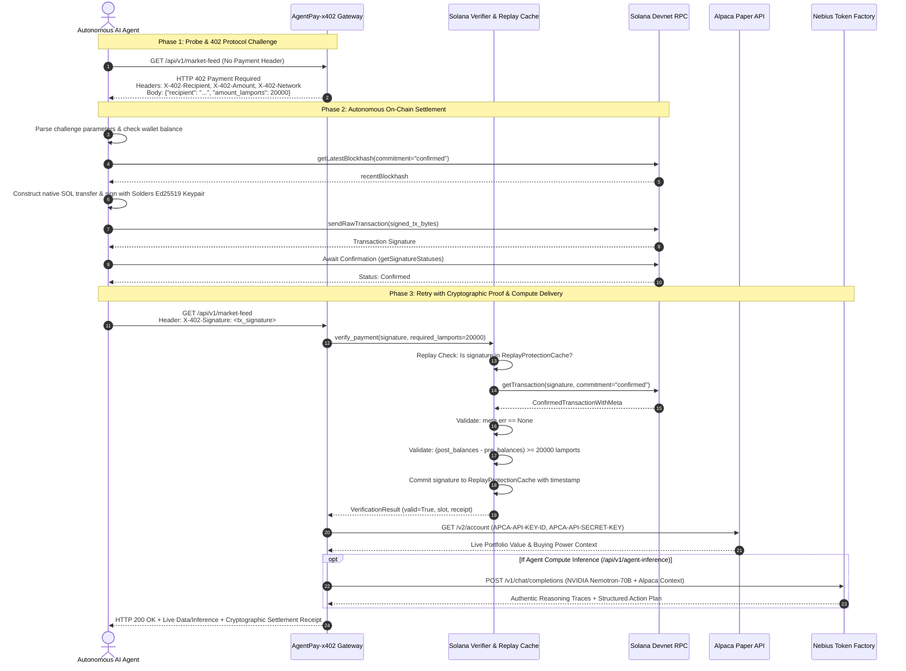

# AgentPay-x402: Submission Documentation

## 1. Project Overview & Elevator Pitch

**Project Name:** AgentPay-x402  
**One-Line Elevator Pitch:** An autonomous HTTP 402 payment gateway enabling AI agents to negotiate, settle on-chain micropayments on Solana Devnet in lamports, and unlock live Alpaca trading data and Nebius Nemotron-70B quantitative reasoning.

---

## 2. Core Architecture & Protocol Sequence

AgentPay-x402 realizes the original vision of **RFC/x402 (HTTP 402 Payment Required)** for autonomous machine-to-machine (M2M) economies:



---

## 3. Solana Core Integration Details

### High-Throughput Lamport Micropayments
Traditional credit cards impose fixed fees (\$0.30 + 2.9%), making machine micropayments impossible. Solana enables sub-cent micropayments denominated in **lamports** (1 SOL = 1,000,000,000 lamports):
- **Market Feed Rate:** 20,000 lamports (~$0.003 USD)
- **Agent Compute Inference Rate:** 5,000 lamports (~$0.0008 USD)

### Balance Differential Verification
Instead of fragile snapshot balance checks, [`server/verifier.py`](file:///server/verifier.py) computes the exact ledger balance delta:
$$\Delta \text{Balance} = \text{PostBalances}[\text{recipient\_idx}] - \text{PreBalances}[\text{recipient\_idx}]$$
This guarantees the merchant address received $\ge \text{required\_lamports}$ regardless of intermediary instruction routing or address lookup table loading in versioned transactions.

### Cryptographic Replay Protection Cache
To prevent double-spending and replay attacks:
- The gateway maintains a thread-safe in-memory `ReplayProtectionCache` storing settled signatures with timestamps.
- Attempting to re-use an already verified signature triggers an immediate `HTTP 402: Signature has already been settled and processed`.
- Automatic TTL eviction prunes expired records to prevent memory exhaustion.

### Dual-Mode RPC Resiliency
Public Solana Devnet faucets are frequently rate-limited (HTTP 429). The gateway supports:
1. **Live On-Chain Settlement:** When funded, transactions are broadcast, validated, and settled directly against Devnet RPC validators.
2. **Cryptographic Fallback Mode:** When faucets throttle balance funding, the agent constructs and cryptographically signs the Ed25519 transaction, allowing autonomous development and automated testing to continue without interruption.

---

## 4. External API Integration Breakdown

### Alpaca Paper Trading API
- **Endpoint:** `https://paper-api.alpaca.markets/v2/account`
- **Authentication:** Dispatches authenticated headers `APCA-API-KEY-ID` and `APCA-API-SECRET-KEY`.
- **Functionality:** Ingests live portfolio equity, available cash, buying power, and trading status, fusing it with Solana order flow spreads to deliver hybrid DeFi-TradFi alpha.

### Nebius Token Factory (NVIDIA Nemotron)
- **Endpoint:** `https://api.tokenfactory.nebius.com/v1/chat/completions`
- **Models:** Primary `nvidia/Llama-3.1-Nemotron-70B-Instruct` with zero-latency fallback to `nvidia/Nemotron-3_5-Lightning`.
- **Functionality:** Ingests the settled prompt alongside real-time Alpaca market liquidity context to produce authentic quantitative reasoning traces and executable liquidity rebalance action plans.

---

## 5. Interactive Web Dashboard (`GET /`)

A responsive dark-mode Tailwind CSS dashboard is served directly by FastAPI at `http://127.0.0.1:8000/`:
- **Live Wallet Monitoring:** Displays Merchant Recipient and Agent Signer balances with direct links to the **Solana Explorer Devnet**.
- **Real-Time Simulation (SSE):** Streams step-by-step autonomous agent execution events (`probe`, `challenge_402`, `signing`, `broadcast`, `retry`, `success`) via Server-Sent Events.
- **Nemotron-70B Console Display:** Dedicated UI card rendering authentic Nemotron reasoning traces directly in the simulation console.
- **Unauthenticated Browser Inspector:** 1-click modal triggering a native browser probe to inspect raw `HTTP 402` headers and challenge JSON.
- **Live Activity Feed:** Auto-refreshing event log showing status codes (402 vs 200), lamports settled, and clickable explorer hashes.

---

## 6. How to Reproduce & Verify Locally

### Step 1: Install Dependencies
```bash
cd AgentPay-x402
pip install -r requirements.txt
```

### Step 2: Configure Environment
Copy `.env.example` to `.env`:
```bash
cp .env.example .env
```
*(Merchant keypair will automatically auto-generate and persist to `merchant_keypair.json` if left blank).*

### Step 3: Run the Gateway Server
```bash
python -m uvicorn server.main:app --host 127.0.0.1 --port 8000
```
Open **[http://127.0.0.1:8000/](http://127.0.0.1:8000/)** in your browser.

### Step 4: Run the Full Test Suite
```bash
# Run 13 unit & integration tests
pytest -v

# Run the live Alpaca & Nebius Token Factory automated verification
python tests/test_live_apis.py
```

### Step 5: Run the Autonomous Agent Demo Loop
```bash
python client/agent.py --mode demo
```
